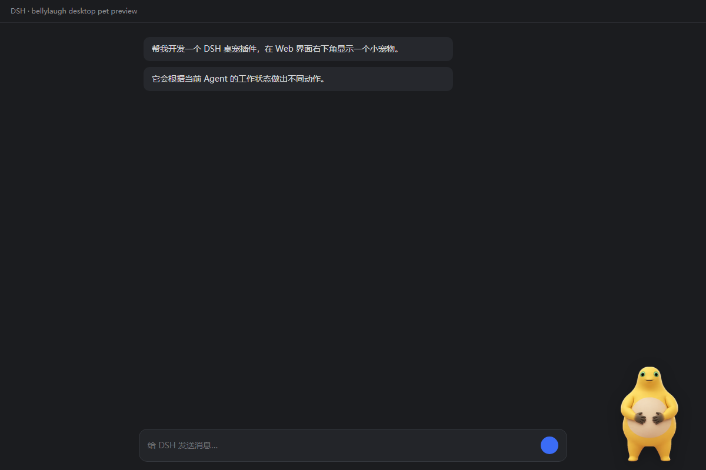
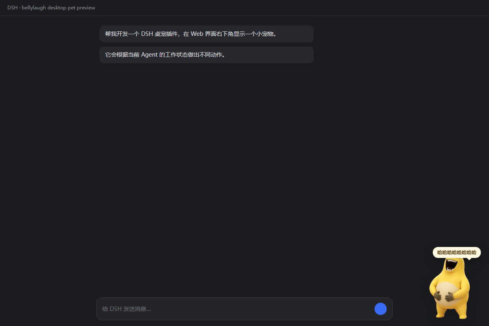
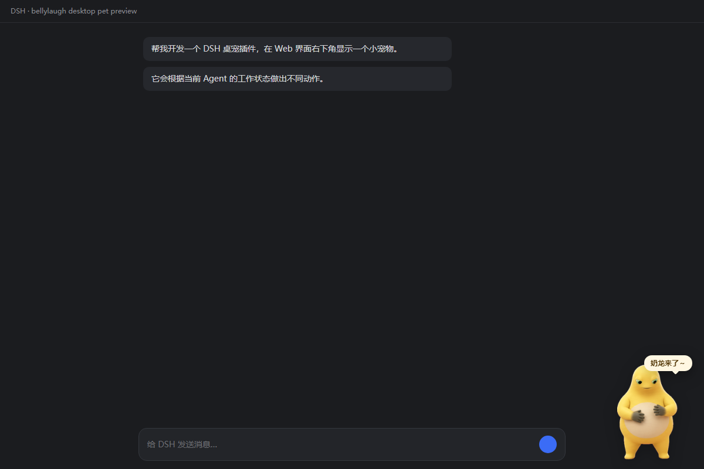

# dsh-pet-bellylaugh · 奶龙桌宠

> 一个 [DeepSeek Harness](https://github.com/deepseek-ai)（DSH）桌面宠物插件：把奶龙放在 Web 界面右下角，
> 动作跟着 Agent 的工作状态走，任务完成时捧腹大笑，并放一段「哈哈哈哈哈哈哈哈」。

<p align="center">
  
  
</p>

<p align="center">
  
  
</p>

- 🐣 **零依赖**：宿主半只用 Node 内置模块，浏览器半只碰 DOM / fetch / Audio
- 🎞️ **状态驱动**：待机 / 工作中 / 工具跑完 / 任务完成 / 出错，五种反应
- 🖱️ **可拖动**：拖着走、松手记住、右键归位
- 🎵 **音频可热换**：往 `assets/` 丢一个 `laugh.*` 就换掉了，不用改代码、不用重启
- 🧩 **素材可换**：覆盖 `assets/spritesheet.webp` 就是换宠物（8 列 × 9 行、单帧 192×208）

## 目录

```
dsh-pet-bellylaugh/
├─ package.json          # dsh.bundle.patch + dsh.client 声明
├─ cordis.patch.yml      # bundle 自带的 loader 插入项
├─ lib/host.js           # 宿主半：监听 Agent 事件 + 提供 HTTP 接口
├─ lib/client.js         # 浏览器半：渲染桌宠、播动画、放声音
├─ assets/spritesheet.webp   # 默认宠物（8×9）
├─ assets/pet.json           # 默认宠物的名字
├─ assets/laugh.mp3
├─ assets/pets/<名字>/       # 可选：放别的宠物，优先于默认那只
├─ preview/*.png
├─ tools/preview.mjs         # 假宿主预览，不装 DSH 也能看
├─ LICENSE               # MIT（仅覆盖代码）
└─ NOTICE                 # 素材版权说明
```

两半的分工刻意做得很薄：宿主只负责把"现在忙不忙 / 刚干完什么"变成一个 JSON，
浏览器端每 500ms 拉一次。没有 RPC、没有 SSE、没有 WebSocket，出问题一眼就能看出来。

## 安装

```yaml
# 在你 profile 的 cordis.patch.yml 末尾追加
- insert:
    - id: ui-pet-bellylaugh
      name: 'dsh-pet-bellylaugh'
```

再把本目录放进该 profile 的 `node_modules/`（软链、junction 或直接 `dsh plugin --profile <name> add <本目录>` 都行）。

生效方式：

- 改 `cordis.patch.yml` 后配置**热重载**，不用重启应用；
- 浏览器端插件是在渲染 `index.html` 时注入的，所以要**刷新一次页面**才看得到宠物；
- 改了 `lib/host.js` 需要重启 DSH（Node 的 ESM 缓存按包名留存）。

## 开发时预览（不装 DSH 也能看）

浏览器端的动作完全由 `/state` 驱动，所以可以拿一个假宿主单独渲染：

```bash
node tools/preview.mjs 18999
# 打开 http://127.0.0.1:18999/?mode=idle|busy|tool|done|error
```

## 动作映射

精灵图是固定的 8 列 × 9 行网格（单帧 192×208），每一行是一段现成的动画。插件只做"选行 + 播帧"：

| 状态 | 触发条件 | 精灵图 | 表现 |
| --- | --- | --- | --- |
| 待机 | 没有 Agent 在跑 | 第 0 行 · 6 帧 · 5.5fps | 站着呼吸、眨眼 |
| 工作中 | 有 Agent 处于 `running` | 第 7 行 · 6 帧 · 7fps | 手在肚子上揉来揉去 |
| 工具跑完 | 每次 Tool 调用结束 | 第 1 / 2 行 · 8 帧 · 13fps | 左右小跑两圈（方向随机） |
| 任务完成 | 最后一个 Agent 回到 `idle` | 第 5 行 ×3 → 第 8 行 | 捧腹大笑再招手，气泡「哈哈哈哈哈哈哈哈」，同时放笑声 |
| 出错 | 本回合有 `agent/error` | 第 6 行 + 抖动 | 气泡「哎呀，好像出错了」 |
| 被戳一下 | 鼠标点宠物 | 第 8 行 · 6 帧 · 9fps | 招手 |

没被用到的第 3、4 行（笑得更凶的两段）保留在表里，想换台词改 `ANIMS` 即可。

## 素材来源

- **形象**：原样拷贝自本地 Codex 的 `~/.codex/pets/bellylaugh/spritesheet.webp`，一像素没改。
- **声音**：由作者从用户本地提供的一段音频转换而来。原文件是 **WMA(ASF) 容器套了个 `.flac` 后缀**，
  Chromium 放不了，所以用 Windows Media Foundation 转成了 `assets/laugh.mp3`
  （192 kbps / 48 kHz / 9.98 s，240 KB）。每次播放 4.2 秒后淡出，不会一直响。

⚠️ 形象和音频属于第三方素材，**不在 MIT 许可范围内**，详见 [NOTICE](NOTICE)。

## 操作

| 动作 | 效果 |
| --- | --- |
| 按住拖动 | 把宠物挪到任意位置，松手记住（存 `localStorage`，刷新后还在） |
| 单击（不拖动） | 招手 + 气泡 |
| **Shift + 单击** | 立刻大笑一次，用来试听当前的音频 |
| 右键 | 回到右下角默认位置 |
| 悬停 → 右上角 🔇 | 静音 / 取消静音 |
| 悬停 → 右上角 🙈 | **隐藏**桌宠，原地留一个小圆点 |

### 隐藏之后怎么找回来

隐藏时宠物原地变成一个 **18px 的半透明小圆点**（鼠标移上去会变实、放大）。
点它、或者按 Tab 聚焦后回车，宠物就回来了。隐藏状态记在 `localStorage`
（`dsh-pet-bellylaugh:hidden`），所以刷新页面也还是隐藏的 —— 但那个小圆点始终在，
不存在"藏了找不回来"的情况。想彻底不留痕迹就别用隐藏，直接按下面「怎么卸载」关掉插件。

隐藏期间插件**不轮询、不放声音**（省得一有任务完成就凭空传来笑声）；
重新显示时会静默对齐状态，不会把隐藏期间攒下的事件一次性补播。

## 怎么换音频

**不用改代码，也不用重启** —— 丢文件就行：

1. 把音频放进 `dsh-pet-bellylaugh\assets\`，文件名以 `laugh` 开头，比如 `laugh.wav`。
2. 目录里**修改时间最新**的那个 `laugh.*` 会被选中，旧的不用删。
3. 宿主每 1.5 秒重扫一次目录，`/state` 里带出文件名和版本号（mtime）；版本一变，
   浏览器端就换上新的 URL —— 连刷新页面都不必，下一次大笑就是新声音。
4. 一个 `laugh.*` 都没有时，会退而选 `assets\` 里最新的任意音频文件。

支持的格式：`mp3 / m4a / aac / wav / ogg / opus / flac / webm`（Chromium 能解的那些）。

> ⚠️ **WMA / ASF 不行**。Chromium 解不了这两个容器，得先转成上面任一格式再丢进来。
> 本项目自带的 `laugh.mp3` 就是从这样一个"WMA 套 .flac 后缀"的文件转出来的。

## 怎么换宠物

跟音频一个待遇 —— **不用改代码**。两种方式：

**A. 换掉默认那只**：直接覆盖 `assets\spritesheet.webp`（刷新页面生效）。

**B. 单放一个宠物目录**（推荐，可以和默认那只共存）：

```
assets/
├─ pet.json                # 默认宠物的名字，可留
├─ spritesheet.webp        # 默认那只
├─ laugh.mp3
└─ pets/
   └─ doubao/              # 目录名随意
      ├─ pet.json          # 可选：{"displayName": "豆包"}
      └─ spritesheet.webp
```

规则：

1. 只要 `assets\pets\` 下有宠物，就**优先用它**（多个时取修改时间最新的那个）。
   这条比"按时间取最新"更明确 —— Windows 的普通复制会保留源文件 mtime，
   光比时间会让"刚拷进来的宠物反而不生效"。
2. 网格**列数/行数从图片实际尺寸算**：`宽 ÷ 192`、`高 ÷ 208`。
   所以 8×9（1536×1872）和 8×11（1536×2288）两种 Codex 素材包都能直接用，
   不会把 11 行压成 9 行。
3. 名字取同目录 `pet.json` 的 `displayName`，没有就退回目录名 —— 会用在提示气泡和 tooltip 上。
4. 宿主每 1.5 秒重扫，`/state.pet` 里带 `id / name / columns / rows / v`，版本一变浏览器就换图，
   连刷新都不必。

> 你本机 `~/.codex/pets/` 里那 8 只里，`gugu-gaga` 和 `nai-long-2` 是 8×11 的 v2 素材包，
> 其余是 8×9；把整个文件夹（`pet.json` + `spritesheet.webp`）拷进 `assets\pets\<名字>\` 就能换过去。

行序沿用同一套 Codex 约定（第 0 行待机、第 1/2 行跑、第 5 行大笑、第 7 行拍肚子、第 8 行招手），
所以换任何一只 Codex 宠物，动作映射都成立。

## 怎么卸载

三种，从轻到重：

**⓪ 只是想让它别碍事** → 悬停宠物，点右上角 **🙈 隐藏**。宠物消失，原地留一个小圆点可以点回来。
（想连声音一起停就在隐藏前先点 🔇，或者干脆用下面 ①。）

**① 临时关掉**（保留文件，随时能开回来）

```yaml
# profile 的 cordis.patch.yml 里，给这条加上 disabled
- insert:
    - id: ui-pet-bellylaugh
      name: 'dsh-pet-bellylaugh'
      disabled: true
```

配置**热重载**，改完刷新页面就没了；想开回来把 `disabled` 删掉即可。
DSH 的「设置 → 插件」页面里也有同样的开关。

**② 彻底移除**：删掉 `cordis.patch.yml` 里那条 `insert` 项，再删掉
`<profile>/node_modules/dsh-pet-bellylaugh`（如果是 junction，删链接即可，源目录还在），刷新页面。

> 只想让它安静但不想消失？悬停宠物，点右上角出现的 🔇 图标静音即可（记在 localStorage）。

拖拽用 `pointerdown/move/up` + `setPointerCapture`，位移小于 4px 视为点击，所以"点一下"和"拖一下"不会互相打架。
位置按"距右下角的距离"存储，窗口缩放时会自动夹回可视区域内。

## 可调参数

| 想改什么 | 改哪里 |
| --- | --- |
| 大小 | `lib/client.js` 的 `--dsh-pet-fw` / `--dsh-pet-fh`（保持 12:13，否则会裁帧） |
| 默认位置 / 层级 | `.dsh-pet { right / bottom / z-index }`，默认位置另见 `DEFAULT_POS` |
| 音量 | `VOLUME`（默认 0.85） |
| 笑声时长 | `LAUGH_MS`（默认 4200） |
| 轮询频率 | `POLL_MS`（默认 500） |
| 哪一行演什么 | `ANIMS` 表 |
| 挪不动了想复位 | 右键宠物 |

## 接口

| 方法 | 路径 | 说明 |
| --- | --- | --- |
| GET | `/pet-bellylaugh/state` | 当前快照：`busy`、`running`、`lastTool`、`toolSeq`、`doneSeq`、`errorSeq`、`clientMountedAt`、`laugh{file,v,size}`、`pet{id,name,columns,rows,v}` … |
| GET | `/pet-bellylaugh/sheet` | **当前生效的精灵图**（由目录扫描决定），带版本号 ETag |
| GET | `/pet-bellylaugh/audio` | **当前生效的笑声**（由目录扫描决定），带版本号 ETag |
| GET | `/pet-bellylaugh/assets/<name>` | `assets/` 里白名单扩展名的文件，带 mtime ETag |
| POST | `/pet-bellylaugh/report` | 浏览器端挂载上报，纯诊断 |

文件名只接受纯文件名（拒绝 `/`、`\`、`..`），扩展名必须在白名单里，所以请求路径拼不进文件系统。
媒体一律 `Cache-Control: no-cache` + 基于 mtime/size 的 ETag：文件换了就换校验值，没换就 304。
`clientMountedAt` 非空说明宠物真的挂到页面上了。

## 已知边界

- **最小化窗口时宠物会跟着消失，这是插件模型的硬边界，不是 bug。**
  DSH 桌面端是 Electron 主进程 fork 一个 `ELECTRON_RUN_AS_NODE` 的 Node 子进程来跑 Host 的
  （探测结果：`process.versions.electron = 44.0.0`，但 `process.type` 为空、`require('electron')`
  直接 `Cannot find module`），窗口只归主进程所有；主进程 ↔ Host 子进程的 IPC 只定义了
  `ready` / `shutdown` / `quit-inspection` / `update-tasks` / `platform-session` / `fatal`
  六种消息，没有任何"开窗口 / 置顶 / 托盘"的通道。所以 Host 插件拿不到
  `BrowserWindow` / `screen` / `Tray`，也就做不出独立于应用窗口的桌面悬浮窗。
  宠物活在渲染进程里，窗口不画它就不在。
  → 想做到"最小化也在桌面上"，只能改 DSH 桌面端本体的主进程（会给升级覆盖），
  或者另做一个独立小窗程序，两者都不是插件的范畴。
- **宿主半改不了热**：Node 的 ESM 缓存按包名留存，改了 `lib/host.js` 要重启 DSH 应用；
  只改 `lib/client.js` 刷新页面就够。
- 插件目录若以软链 / junction 方式放进 profile 的 `node_modules`，该 profile 跑
  `pnpm install` 时可能被清掉，重装即可。
- 宠物是 `position: fixed` 贴在 `document.body` 上的独立浮层（`z-index: 8000`），
  不占用 DSH 的 slot 布局，所以模态框、右栏开合都不会把它挤走；反过来它也可能盖住右下角一点点内容，
  拖走或右键归位即可。
- 声音受浏览器自动播放策略约束：页面还没被点过时第一次播放可能被拒，插件会静默吞掉，
  正常用起来（敲过字、点过按钮）之后就不会再被拦。

## 贡献

欢迎 PR。改之前建议先跑 `node tools/preview.mjs 18999`，四种状态都能用 `?mode=` 切出来对比。
提交前请确认：`node --check lib/host.js && node --check lib/client.js`，
并且真机上刷新页面后 `GET /pet-bellylaugh/state` 仍返回 200。

## 许可证

- **代码**：[MIT](LICENSE)
- **素材**（`assets/spritesheet.webp`、`assets/laugh.mp3`）：第三方所有，不在 MIT 范围内，见 [NOTICE](NOTICE)

## 致谢

- 精灵图来自本地 Codex 的 `pets/bellylaugh` 素材包，行序靠逐行裁图确认
  （9 个宠物素材的网格布局一致，说明这是 Codex 的固定动画表）

